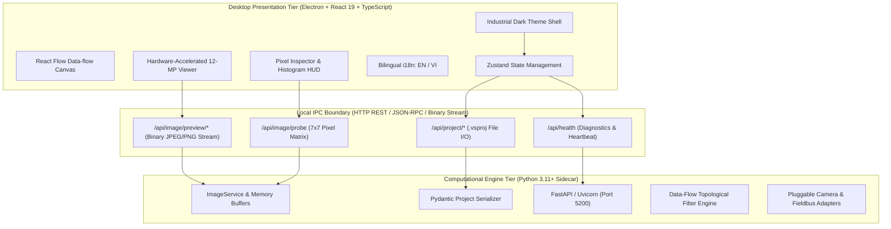

# OptiFlow Vision Studio — System Architecture

**OptiFlow Vision Studio** is an original, deterministic desktop integrated development environment (IDE) designed for graphical, data-flow programming of machine-vision inspection in industrial automation.

---

## 1. High-Level Architecture Overview

OptiFlow Vision Studio couples a modern, hardware-accelerated **Electron + React + TypeScript** desktop frontend with a lightning-fast **Python 3.11+ / OpenCV** computational sidecar engine.

---

## 2. Product Structure: Three Tiers

OptiFlow Vision Studio operates in three distinct operational tiers sharing the exact same underlying computational engine:

1. **Full Development Environment (Editor)**:
   - Full drag-and-drop React Flow visual graph editor.
   - Comprehensive filter library with categories, parameters, and formula expressions.
   - HMI operator screen designer.
   - Diagnostic mode: timing breakdown per node, memory consumption, error tracking.

2. **Simple Mode (End-User Inspector)**:
   - Streamlined, non-destructive interface for line operators and factory technicians.
   - Complexity levels that hide low-level mathematical filters.
   - Inspection thresholds configured through intuitive pass/fail limit panels rather than formula syntax.

3. **Runtime Player**:
   - Lightweight production kiosk execution shell.
   - Runs compiled `.vsproj` projects in lock-down mode.
   - Disables graph editing; displays only configured HMI operator screens, camera streams, and fieldbus diagnostics.

---

## 3. Data-Flow Programming Model

- **Project Composition**: Projects consist of **Programs** (graphs), reusable **Macros** (nested subgraphs), **Worker Tasks** (asynchronous background routines), and **Global Variables/Registers**.
- **Execution Semantics**: Directed acyclic graph (DAG) executed in topological dependency order. A filter runs as soon as all prerequisite inputs are available.
- **Typed Ports**:
  - `Image`: Mono8, BGR, RGB, RGBA multi-channel matrices.
  - `Region`: Binary mask / polygon ROI contour.
  - `Path` & `Profile`: 1D scan paths and intensity profiles with sub-pixel interpolation.
  - `Point2D`, `Segment2D`, `Rectangle2D`, `Circle2D`, `Ellipse2D`.
  - `Number`, `Integer`, `Boolean`, `String`.
  - `Array<T>`: Uniform arrays supporting element-wise broadcasting across filters.
  - `Model`: Geometric edge template / correlation model.
  - `Nil` Handling: Outputs can represent `Nil` (no detection/empty). Filters provide Nil-safe fallback variants (`or-nil`). A `Nil` dispatched to an HMI control leaves the control in its previous valid state without UI flickering.
- **Registers**: Stateful memory registers preserved across continuous inspection loop iterations.

---

## 4. Zero-Lag 12-Megapixel Image Pipeline

A major bottleneck in web-based machine vision tools is base64 string serialization over IPC, which adds 33% memory overhead and heavy JSON parsing lag.

**OptiFlow Architecture eliminates base64 entirely:**
1. Images are stored in native C-contiguous NumPy memory arrays in the sidecar engine.
2. The Electron renderer requests binary streams directly over localhost:
   `GET /api/image/preview/{id}?max_dim=1920&quality=90`
3. Multi-tier downscaling automatically generates responsive pyramid previews for large viewports, while retaining full 12-MP floating-point precision for measurement filters.
4. Real-time Pixel Probe (`/api/image/probe`) returns raw numeric intensity arrays and local $7\times 7$ neighborhoods in $< 0.8$ ms.

---

## 5. Industrial Adapters & Fieldbus Architecture

Hardware interfaces are decoupled behind abstract Python interfaces:
- **Image Acquisition**: Files, image folders, video files, USB webcams (OpenCV), GigE Vision / GenTL (IDS peak, GenICam stubs).
- **Industrial Fieldbus**:
  - Open implementations: TCP/UDP Sockets, Serial RS-232/RS-485, HTTP REST, MQTT, Modbus TCP.
  - Fieldbus stubs: Schneider SERT (`FB_CognexCamera`), OPC UA, PROFINET.
